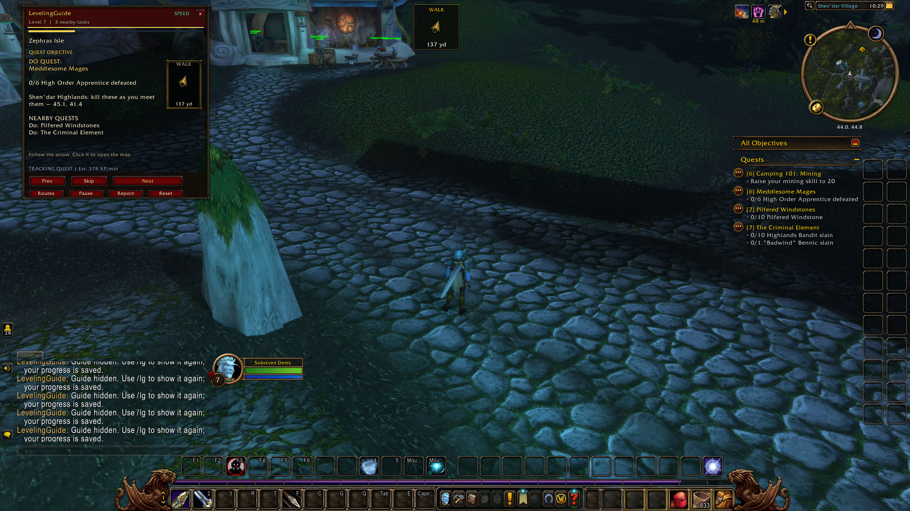

# LevelingGuide for WoW Forever

**Spend less time wondering where to go and more time leveling.** LevelingGuide is a free in-game quest guide for **WoW Forever (Interface 16001)**, with Alliance and Horde routes from level 1 to 60.

[Download the latest release](https://github.com/sobata1995-source/SobiLevelForever/releases) · [Discord community](https://discord.gg/Pr5eMAUqt) · [Report a bug](https://github.com/sobata1995-source/SobiLevelForever/issues/new/choose)

## In-game preview



## What it does

- Shows the quest name, short English instructions, objectives and live progress.
- Tracks accepted, completed and rewarded quests using the state the game exposes, including older completions when available. It advances to the next task automatically where supported.
- Groups nearby tasks and estimates XP per minute to prioritize useful quests while preserving recorded prerequisites and class chains. Speed mode is enabled by default.
- Provides a floating direction arrow, distance and map guidance. Bundled terrain navigation follows available walkable map data and intermediate corners; unsupported or missing routes require manual navigation.
- Includes class training reminders with a Skip button. After it has verified a class trainer's available skills, it can avoid repeating unnecessary training visits.
- Uses a WoW-style window and a minimap button to show or hide the guide. Routes shows all chapters for your faction and race with level ranges and progress labels; Prev avoids already completed quest tasks.
- Saves progress per character and provides a local Report window for troubleshooting.

The guide contains **65 chapters and 10 faction/race starting paths**: Human, Dwarf, Gnome, Night Elf and Alliance Skyborne; Orc, Troll, Tauren, Undead and Horde Skyborne.

## Install

1. Close the game and download **LevelingGuide-0.3.4-beta.zip** from Releases. Use this addon ZIP rather than GitHub's automatic source archive.
2. Extract **all four folders** into your Forever client's `Interface/AddOns` directory:

```text
Interface/AddOns/LevelingGuide/LevelingGuide.toc
Interface/AddOns/SobiLevelNav/SobiLevelNav.toc
Interface/AddOns/SobiLevelNav_EK/SobiLevelNav_EK.toc
Interface/AddOns/SobiLevelNav_Kalimdor/SobiLevelNav_Kalimdor.toc
```

3. Start the game, enable LevelingGuide and its navigation modules, then log in. Type **`/lg`** to open the guide.

No TomTom, API key or external program is needed. The addon guides you; you still move, fight, accept quests, choose rewards and train yourself.

### Updating from SobiLevelForever

Close the game and back up your `WTF` folder. Replace the old addon with the four folders above; do not enable both old and new guide folders. The saved globals remain `SobiLevelForeverDB` and `SobiLevelForeverProgress`. For the folder rename, copy the old `SobiLevelForever.lua` SavedVariables file to `LevelingGuide.lua` in the same directory, both under account SavedVariables and each character's SavedVariables. Keep the contents unchanged. Do not delete the old files until your progress is confirmed.

## Controls

| Control | Action |
| --- | --- |
| `/lg` | Open the guide and command help. |
| Minimap button | Left-click to show/hide; right-click for Routes; drag to reposition. |
| Skip | Skip a task or a training reminder. |
| Reset | Confirm a guide reset after accidental Next/Skip clicks; game quest completion is retained. |
| Pause / Resume | Stop or resume automatic guide progression. |
| Routes | Browse all faction/race chapters, their levels and progress. |
| Report or `/lg report` | Open copyable diagnostics; nothing is sent automatically. |
| `/lg speed on` | Enable quest filtering and XP-priority estimates. |
| `/lg smart on` | Enable nearby-task planning. |
| `/lg training on` | Enable skippable class training reminders. |

## Public beta: help improve the routes

**Version 0.3.4-beta is ready for community testing.** Early leveling has been tried in game and automated checks cover the route data, progression, filtering, UI and navigation logic. A complete 1–60 playthrough for every race/class has not been verified. XP/time priorities are estimates, not measured speedrun records. Terrain coverage, server quest changes and historical quest/training information can be incomplete. Training learned before installation cannot always be detected until the addon checks the trainer.

If a step is wrong, use Skip and [report it on GitHub](https://github.com/sobata1995-source/SobiLevelForever/issues/new/choose) or [Discord](https://discord.gg/Pr5eMAUqt). Include:

- Addon version, character level, faction, race and class.
- Route, step number and quest name/ID.
- What happened, what you expected and how to reproduce it.
- A screenshot and the text from **Report**; for navigation bugs, include map/zone and coordinates.

Review diagnostic text and remove private details before posting. Suggestions and feedback are welcome too.

## Community and optional support

Created and maintained by **Razer Dev Studio / Denis Aleksandrov**. The addon is **free to download and use**. Donations are optional; testing and useful bug reports help just as much.

- [Join Discord](https://discord.gg/Pr5eMAUqt)
- [Donate / leave a tip with Revolut](https://revolut.me/denisar2z)
- [Support development on Patreon](https://www.patreon.com/c/DenisAleksandrov/membership)

## Credits and source

Guide data is adapted from the free [Polestar project](https://github.com/fitzforge/polestar), with original sources, attribution, conversion information and licenses included in `LevelingGuide/Data/Source`, `LevelingGuide/Data/Licenses` and `LevelingGuide/LICENSE_THIRD_PARTY.md`. The navigation modules retain their upstream source and notices. This distribution is provided under GPLv3; consult each included license for component details. LevelingGuide is an independent community addon and is not affiliated with RestedXP. It contains no proprietary RestedXP guides.
